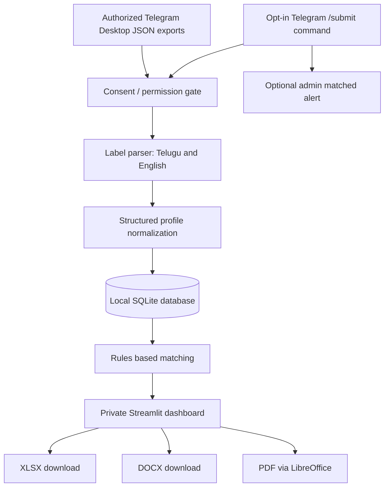

# Architecture and implementation decisions

## Data flow

## Tables

`profiles(id PK, name, dob, age, nakshatram, rashi, birthplace, birthtime, education, location, source_name, source_ref, source_kind, submitted_by, message_date, fingerprint, duplicate_of, inserted_at)`

- `id`: SHA-256 truncated of `source_kind:source_name:source_ref`; prevents duplicate ingestion of same message.
- `fingerprint`: SHA-256 truncated of normalized `name|dob`; flags **potential** duplicate only when both known.
- `source_ref`: export message ID or bot `chat ID:message ID`, but no guesswork for private Telegram permalink.
- `submitted_by`: bot submitter's Telegram numeric user ID for profile revocation; absent for old exports.
- Raw message content, contact numbers and photos are not saved; only selected profile fields.

## Match semantics

For each configured filter:

1. Known value that fails a rule => `No match`.
2. Missing value => `Needs review`, unless another known field is a definite no-match.
3. All requested values pass => `Match`.
4. Age is recalculated from DOB for matching when available; alternatively uses explicit age with caveats.
5. Comma-separated stars are treated as `OR`; independent filters are combined as `AND`.

## Consent model

The local dashboard requires a human checkbox confirmation before an import and imports only history messages visibly tagged `CONSENT:YES`. The bot requires `CONSENT:YES` in an explicitly addressed `/submit` command; optionally only configured groups may submit. This is an **attestation** not independent verification of the bride's consent. For real group-wide adoption, obtain explicit permission from the people in profiles (and group authorization), publish purpose/retention info, and support revocation. Do not repurpose exports for data aggregation or AI development.

## Security and operations

- `.env` and `data/*` are excluded from Git; keep all keys and session data secret.
- SQLite is local and **not encrypted at rest**; restrict OS file permissions and use full disk encryption.
- Streamlit has no authentication in this starter; do not expose via an open public IP. For mobile, use authenticated private VPN/zero-trust gateway, then enforce login before production.
- Run the bot only on an always-on device to receive submissions promptly; `run_polling` will resume, but missed updates during long downtime depend on Telegram update retention.
- Respect profile deletion requests and separately remove prior downloadable copies.
- Schedule encrypted backups and define retention limits before storing actual profile data.

## Suggested production evolution

- Authentication and per-user filter presets; verified consent and revocation process.
- Human-review UI for complex formats / photos / inconsistent DOB.
- Optional OCR only for explicit-submission biodata in an authorized environment.
- Tamper-evident consent audit, deletion queues and report expiration.
- HTTPS + auth for mobile usage; Postgres if concurrent multiuser access becomes necessary.

## Telegram matching bot upgrade

`bot.py` implements personal saved requirements for numeric allowlisted `AUTHORIZED_USER_IDS`. A person can use `/matches` only in private chat; group submissions use `/submit CONSENT:YES` in allowlisted groups. `preferences.py` stores user filters in SQLite; new matching submissions trigger a private one-line alert. No ordinary group conversations or history are passively indexed by the bot.
